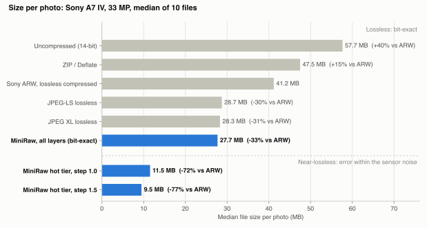
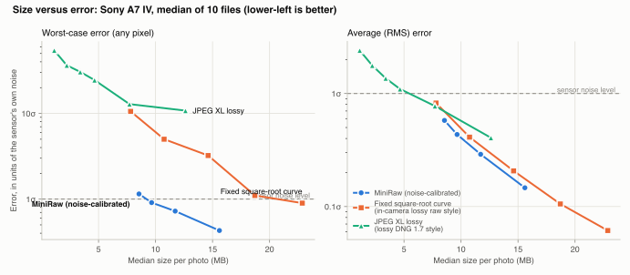
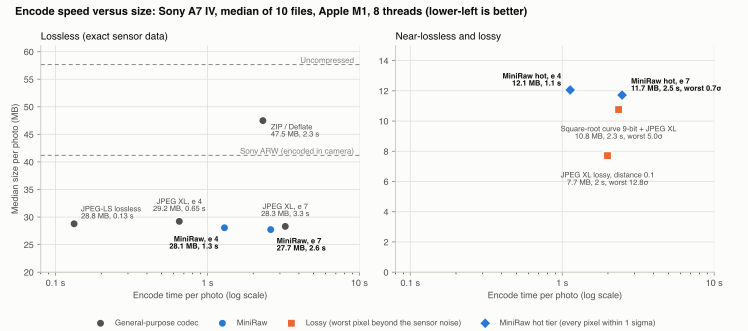

# MiniRaw

A layered RAW codestream, Phase 1 prototype (formerly "StrataRAW"; see [SPEC.md](SPEC.md)).

| Layer | Contents |
| --- | --- |
| L0 header | Sensor metadata, per-plane noise model, quantisation tables (`lo`), section table |
| L1 base | Low-resolution image in the noise-normalised domain (also the preview/index source) |
| L2 signal | Full resolution, quantised to a fraction of local noise sigma, tiled JPEG XL lossless |
| L3 noise | Exact remainder inside each quantisation bin, range-coded, tiled; can be stripped or split |

Decode modes: `index` (L0), `preview` (L0+L1), `signal` (L0..L2, error bounded by the noise model),
`exact` (L0..L3, bit-exact). `signal` and `exact` support region decode that reads only the touched tiles.

## Results

These are measured on 10 photos from a Sony A7 IV (33 MP, 14-bit, lossless-compressed ARW). Each figure is the
median over the 10 files.

- **Hot tier (L0-L2): 11.5 MB per photo, 72% smaller than the 41.2 MB ARW.** No pixel is off by more than 0.61x
  the sensor's own noise at that brightness.
- **Every layer together: 27.7 MB, sensor-exact** (every sensor value bit for bit). That is 33% smaller than the
  ARW and 2% smaller than JPEG XL lossless (28.3 MB, also sensor-only), so keeping the exact data costs nothing
  extra. The cold layer (L3) can be split off to cheaper storage.
- **File-exact: 30.9 MB, 25% smaller than the ARW.** This restores the original ARW byte for byte. It adds the
  ARW's container (0.18 MB, hot) and its embedded previews (3.0 MB, cold, losslessly repacked) to the sensor
  data.

<picture>
  <source media="(prefers-color-scheme: dark)" srcset="docs/img/size_dark.svg">
  
</picture>

The step size trades hot-tier size against error. It also affects the lossless total: smaller steps shrink the
full bit-exact file further, but make the hot tier larger (about 30% at `--step 0.5`). The default, 1.0, favours
the hot tier.

For a smaller file, the step trades size against error. In the chart below, error is in units of the sensor's own
noise (sigma) at each pixel's brightness, so 1 sigma is "as large as the noise already in the photo".

<picture>
  <source media="(prefers-color-scheme: dark)" srcset="docs/img/quality_dark.svg">
  
</picture>

How to read the size-versus-error chart:

- **Worst-case error is where MiniRaw differs.** MiniRaw fits the noise level for each sensor and brightness, so
  at 9.5 MB no pixel errs by more than 0.86 sigma. At a similar 10.8 MB, a fixed square-root curve (the
  approach of in-camera lossy raw modes) reaches 2.35 sigma, in the shadows and highlights where the curve
  doesn't match the sensor. At 12.6 MB, JPEG XL lossy reaches 6.5 sigma; it is tuned for how displayed images
  look, not for raw data that will be pushed and graded.
- **Average error is a tie with the square-root curve.** The saving comes from not storing noise. Calibration
  adds a guarantee for every pixel, not a smaller average.

Encode speed matters as much as size for day-to-day use:

<picture>
  <source media="(prefers-color-scheme: dark)" srcset="docs/img/speed_dark.svg">
  
</picture>

- **Lossless.**
  - At effort 7, MiniRaw is smaller *and* faster than JPEG XL lossless: 27.7 MB in 3.4 s against 28.3 MB in
    4.5 s. JPEG XL finds MiniRaw's prediction residuals cheaper to model than raw pixels, and the exact layer
    is range-coded.
  - At the default effort 4, MiniRaw takes 1.7 s for 28.1 MB.
  - JPEG-LS is the fastest lossless option (0.15 s) and about 4% larger.
- **Near-lossless.**
  - MiniRaw's hot tier encodes in 1.4 s (effort 4) and keeps every pixel within the sensor noise.
  - The lossy methods reach similar or smaller sizes in about 3 s, but their worst pixels are 2-9x the noise.

Timing: Apple M1, from sensor data already in memory, so reading the file and decoding the raw are excluded.
Tiled codecs encode the four Bayer planes in 512-pixel tiles on 8 threads, as MiniRaw does. ZIP is
single-threaded, as zip tools are. The camera's own ARW encoder runs in hardware and is shown only as a size line.
Medians of 10 files; the data is in `results/experiments/speed_personal_raws.csv`.

Methods, all on the same sensor data:
- JPEG-LS, JPEG XL lossless and the square-root curve code the four Bayer planes in 512-pixel tiles at JPEG XL
  effort 7, the same tiles and effort as MiniRaw.
- JPEG XL lossy uses distances 0.05 to 1.0. Its output is clipped at the white level.
- The ARW size includes about 3.7 MB of embedded previews and metadata; its raw data alone is 37.5 MB.

Not included: learned codecs (e.g. RAWIC, which needs a GPU), and other manufacturers' proprietary lossy modes,
which can't be run on these files.

These figures come from one camera. The 20-camera dev set (older 2003-2009 sensors) is in
[results/report.md](results/report.md), and this set's full report is in
[results/report_personal_raws.md](results/report_personal_raws.md).

To regenerate the charts from your own files:

```sh
python -m bench.run --dir YOUR_FOLDER --quick
python -m bench.experiments.readme_chart_data YOUR_FOLDER
python -m bench.experiments.speed_chart_data YOUR_FOLDER
python -m bench.experiments.readme_charts YOUR_FOLDER_NAME
```


## Setup

```sh
python3 -m venv .venv && .venv/bin/pip install -e '.[dev]'
.venv/bin/python -m pytest              # M0-M3 acceptance tests on synthetic data
```

## CLI

```sh
miniraw encode IN.ARW OUT.mraw [--step 1.0] [--effort 4] [--no-l3] [--no-original] [--threads N]

# decode: the output type follows the extension
miniraw decode IN.mraw OUT.ARW                 # the original raw file: byte for byte with L3, near-lossless without
miniraw decode IN.mraw OUT.dng                 # raw again: bit-exact sensor data (verified), lossless-JPEG DNG
miniraw decode IN.mraw OUT.jpg                 # developed with LibRaw, camera WB, EXIF kept
miniraw decode IN.mraw OUT.png --bits 16       # also .tif; --exposure EV, --half-size, --no-auto-bright
miniraw decode IN.mraw thumb.jpg --mode preview      # from the base layer only (~40 ms)
miniraw decode IN.mraw crop.jpg --region x,y,w,h     # reads only the touched tiles
miniraw decode IN.mraw OUT.npy | OUT.json      # raw mosaic array | header
miniraw info IN.mraw
miniraw strip IN.mraw        # drop L3 in place
miniraw split IN.mraw        # move L3 to IN.mraw.l3 (decode with --sidecar IN.mraw.l3)
```

Default decode modes: `exact` for `.dng` and `.npy` when L3 is present (`signal` with a note if the file is
stripped), `signal` for images (visually identical, about twice as fast). The DNG carries the colour matrix,
white balance, black and white levels, default crop, orientation and capture EXIF recorded at encode time.
It reproduces the sensor data exactly, in a standard format.

**Restoring the original file.** `encode` also keeps everything else in the original raw file, as long as its
sensor data is stored as lossless-JPEG tiles (Sony ARW lossless, lossless DNG). That means the TIFF structure,
maker notes and embedded previews (repacked losslessly). Decoding to the original extension (`OUT.ARW`, matched
case-insensitively) re-encodes the tiles with the file's own Huffman tables and returns the identical file,
checked against its SHA-256.

This is verified when encoding. If a file can't be reproduced exactly, `encode` says why, and decoding to `.dng`
still works.

What it costs, per 33 MP ARW:
- **Hot tier: about 0.4 MB** for the container (TIFF structure, maker notes, small previews).
- **Cold tier: about 1-4 MB** for the camera's full-size preview JPEG, repacked losslessly.

**Without L3** (`--no-l3`, `strip`, `bundle --cold drop`), decoding to `OUT.ARW` still gives a valid ARW: same
structure, maker notes and EXIF, with the near-lossless pixels and a full-size preview regenerated from them. It is
checked by reading it back with LibRaw, opens like any ARW, and is about the original's size. It is not
byte-identical, since the exact pixels live in L3.

`--no-original` skips the container and previews. Raw formats that compress the sensor data differently (NEF, CR2,
CR3, compressed ARW, ...) decode to DNG.

## Bundle a whole folder

```sh
miniraw bundle ~/Photos/2026-09-Alaska trip.zip                 # everything restorable exactly
miniraw bundle ~/Photos/2026-09-Alaska trip.zip --cold split    # trip.zip (hot) + trip.l3.zip (cold)
miniraw bundle ~/Photos/2026-09-Alaska trip.zip --cold drop     # near-lossless raws only, smallest (= --no-l3)
miniraw unbundle trip.zip restored/                              # raws come back as DNG
miniraw unbundle trip.zip previews/ --raw-as jpg                 # or as developed JPEGs
miniraw unbundle trip.zip --list
```

`bundle` accepts the same encoding flags as `encode` (`--step`, `--effort`, `--no-l3`, `--threads`). It walks the
folder, keeps its structure, and writes one zip:

| In the folder | In the bundle | Restored as |
|---|---|---|
| Raw files (2x2 Bayer: ARW, NEF, CR2/CR3, DNG, ...) | `.mraw` | the identical file where supported (Sony ARW lossless, lossless DNG); otherwise DNG with bit-exact sensor data. `--raw-as dng/jpg/png/tif/mraw` for other forms |
| JPEG | lossless JPEG XL repack, about 21% smaller | the identical JPEG, byte for byte |
| PNG | stored; or lossless JPEG XL with `--png repack`, about 42% smaller | identical bytes; or identical pixels (only PNGs without colour or text metadata are repacked) |
| Anything else (sidecars, video, X-Trans raws, ...) | stored as-is | the identical file |

A `manifest.json` in the zip records every file's path, size, SHA-256 and modification time. `unbundle` checks each
restored file against it and restores the modification times. On 10 Sony A7 IV RAW+JPEG pairs, the 456 MB folder
became a 355 MB bundle (-22%), and unbundling gave back an identical folder: `diff -r` is clean, including all 10
ARWs byte for byte. With `--cold split`, the main zip holds the near-lossless raws and the JPEGs (153 MB). The
`.l3.zip` holds everything needed to restore the exact originals.

Without the `.l3.zip`, or with `--no-l3`, unbundling still gives back ARWs under their original names, holding
near-lossless pixels. On the same folder, a `--no-l3` bundle is 155 MB (-66%) and unbundles to 10 valid ARWs plus
the identical JPEGs.

**Why JPEG and PNG don't get MiniRaw's treatment.** MiniRaw saves space by not storing the random sensor noise in
linear raw data. By the time a photo is a JPEG or PNG, it has been demosaiced, denoised, tone-curved and rounded
to 8 bits, and the remaining noise is smaller than one 8-bit step, so there is nothing to drop. Measured on 16
JPEGs, applying the method gave files 4x larger than the original JPEG. Lossless JPEG XL repacking is the right
tool for those files, and the bundle uses it (`bench/experiments/jpeg_png.py`).

## Try it on your own raw file

```sh
python -m bench.eval PATH/TO/IMG.NEF                  # sizes, checks, step sweep, B5 comparison
python -m bench.eval IMG.CR2 --render out/ --out IMG.mraw   # + render comparison crops, keep the .mraw
python -m bench.eval IMG.ARW --quick                  # skip the sweep and B5
```

Any 2x2-Bayer raw that LibRaw (rawpy) opens works: NEF, CR2, CR3, ARW, DNG, RAF (Bayer models), ORF, RW2 and others.
Use the camera's lossless or uncompressed raw mode: lossy raw modes (e.g. Nikon "compressed", Sony "compressed")
have already discarded data, and the script warns when it detects that.

## Benchmark

```sh
python -m bench.datasets --split dev        # 20 FiveK DNGs, one per camera (~200 MB)
python -m bench.run --split dev             # per-image CSVs in results/per_image/dev/ (resumable)
python -m bench.report --split dev          # results/report.md
```

Settings live in `configs/phase1.toml`. Every departure from the spec is in
[results/DEVIATIONS.md](results/DEVIATIONS.md).

## Layout

```text
src/miniraw/   io_raw, noise, vst, layers, entropy, container, codec, cli
baselines/     b1_native (DNG strip bytes), b2_jxl (JPEG XL lossless), b5_sqrt (uncalibrated sqrt curve)
bench/         datasets, synth, metrics, run, report, splits/
tests/         M0-M3 acceptance tests
results/       generated; never edited by hand (except DEVIATIONS.md)
```
