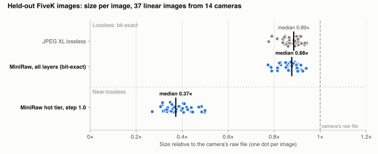
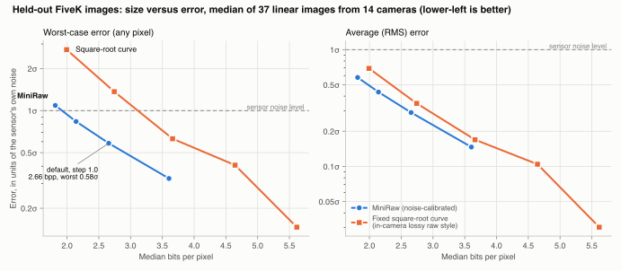

# MiniRaw

A layered file format for raw photos: a compact copy accurate to within the sensor's own noise, an optional layer
that restores every sensor value bit for bit, and a built-in search thumbnail. File format version 2 (the v1.0
README is archived in [docs/readme_v1.md](docs/readme_v1.md)).

A raw photo is mostly noise, and noise doesn't compress. MiniRaw measures each image's noise, keeps the part of every
value that rises above it in a **hot tier**, and moves the rest into a **cold layer** that can live on cheaper
storage or be dropped.

| Part | Contents | Tier |
| --- | --- | --- |
| Header (L0) | Sensor metadata, noise model, quantization tables, technical statistics, optional search embedding | Hot |
| IDX | A 512 px index thumbnail (JPEG XL, about 34 KB) | Hot |
| L2 signal | Every sensor value, quantized to a fraction of the noise at its brightness, in 512 px tiles | Hot |
| L3 noise | Each value's exact position inside its quantization bin | Cold |
| Original container and previews | Enough to rebuild the original raw file byte for byte (Sony ARW lossless, lossless DNG) | Hot / cold |

Decode modes:
- `index`: header only.
- `preview`: the thumbnail.
- `signal`: every value within the noise bound.
- `exact`: bit-exact, verified against the original's SHA-256.

`signal` and `exact` also decode a rectangle, reading only the tiles it touches.

## Results

Measured on 60 MIT-Adobe FiveK raw files never used to develop the codec (37 are linear raw, from 14 cameras of
2003-2009; the rest were processed in camera and are checked but not counted in sizes). Medians over images.

| | MiniRaw format 2 |
| --- | --- |
| **Hot tier** | **0.37x the camera's raw file**, 0.42x JPEG XL lossless |
| Worst pixel in the hot tier | 0.58x the sensor's own noise (no pixel outside the error bound) |
| **Every layer, sensor-exact** | **0.88x the camera's file, 0.987x JPEG XL lossless** |
| Exact decodes matching the original's hash | 60 of 60 |
| Indexing a file | One 16 KB header read with a stored embedding; about 51 KB to re-index |

<picture>
  <source media="(prefers-color-scheme: dark)" srcset="docs/img/fivek_holdout2_v2_size_dark.svg">
  
</picture>

**The error bound is per pixel.** The step sets the trade-off: in units of the noise at each pixel's brightness, no
value moves more than half a step (plus one raw unit). Against a fixed square-root curve, the approach of in-camera
lossy raw modes, MiniRaw is smaller at the same worst-case error and about equal at the same average error:

<picture>
  <source media="(prefers-color-scheme: dark)" srcset="docs/img/fivek_holdout2_v2_quality_dark.svg">
  
</picture>

**Search.** On 493 more unseen FiveK images, embeddings of the `IDX` thumbnail match those of a full-resolution
render closely:
- Neighbour overlap@10 is 0.84 under CLIP and 0.86 under SigLIP. The camera's own embedded thumbnail scores 0.67 and
  0.69.
- Zero-shot classification is within 1 point of the full render.
- The plan's target of 0.90 overlap is not met; JPEG XL compression of the thumbnail costs about 0.07.

**What format 2 changed** (against format 1 on the same 60 images): hot tier -1.8%, lossless total -1.2%, and the
reconstruction bias -38% with no bound violations. The format 1 base layer (L1) is gone, because L2 coded better
without it, and `IDX` replaces it for preview and search. Details: [results/v2_benchmark.md](results/v2_benchmark.md).

**On one modern camera** (10 Sony A7 IV files, format 1): the hot tier was 0.28x the 41.2 MB lossless ARW, every
layer 2% under JPEG XL lossless, and the original ARW restored byte for byte at 30.9 MB. That set was used to tune
the codec; its charts are in [docs/readme_v1.md](docs/readme_v1.md).

**Limitations.**
- 2x2 Bayer sensors only.
- Byte-exact restore of the original file only for lossless-JPEG-tiled raws; everything else restores as DNG with
  bit-exact sensor data.
- The held-out cameras are 2003-2009 models.
- The spec's per-decile bias check (0.02σ) still fails on real images.
- The noise estimate can run high on textured, low-noise images.

Details in [docs/METHOD.md](docs/METHOD.md#13-limitations-and-open-problems).

## Setup

```sh
python3 -m venv .venv && .venv/bin/pip install -e '.[dev]'
.venv/bin/pip install -e '.[index]'      # optional: search embeddings (OpenCLIP, PyTorch)
.venv/bin/python -m pytest
```

## CLI

```sh
miniraw encode IN.ARW OUT.mraw [--step 1.0] [--effort 4] [--no-l3] [--no-original] [--threads N]
miniraw encode IN.ARW OUT.mraw --embed           # also store a CLIP embedding of the thumbnail (needs [index])
miniraw encode IN.ARW OUT.mraw --format-version 1   # a file MiniRaw v1.0 readers decode

# decode: the output type follows the extension
miniraw decode IN.mraw OUT.ARW                 # the original raw file: byte for byte with L3, near-lossless without
miniraw decode IN.mraw OUT.dng                 # raw again: bit-exact sensor data (verified), lossless-JPEG DNG
miniraw decode IN.mraw OUT.jpg                 # developed with LibRaw, camera white balance, EXIF kept
miniraw decode IN.mraw OUT.png --bits 16       # also .tif; --exposure EV, --half-size, --no-auto-bright
miniraw decode IN.mraw thumb.jpg --mode preview      # the stored 512 px thumbnail
miniraw decode IN.mraw crop.jpg --region x,y,w,h     # reads only the touched tiles
miniraw decode IN.mraw OUT.npy | OUT.json      # raw mosaic array | header
miniraw info IN.mraw         # sizes, noise model, technical statistics, thumbnail, embeddings
miniraw strip IN.mraw        # drop the cold layer in place
miniraw split IN.mraw        # move it to IN.mraw.l3 (decode with --sidecar IN.mraw.l3)
```

- **Default decode modes.** `.dng` and `.npy` get `exact` when L3 is present; images get `signal`, which looks
  identical and is about twice as fast.
- **The DNG** carries the colour matrix, white balance, black and white levels, default crop, orientation and
  capture EXIF.
- **Old files.** Files written by MiniRaw v1.0 decode exactly as before.

**Restoring the original file.** When the sensor data is stored as lossless-JPEG tiles (Sony ARW lossless, lossless
DNG), `encode` keeps the file's TIFF structure and maker notes (hot, about 0.2-0.4 MB) and its embedded previews
(cold, repacked losslessly). Decoding to the original extension then returns the identical file, checked against
its SHA-256. Without the cold layer, it returns a valid file in the same format holding the near-lossless pixels.
Other raw formats decode to DNG; `--no-original` skips this.

## Bundle a whole folder

```sh
miniraw bundle ~/Photos/2026-09-Alaska trip.zip                 # everything restorable exactly
miniraw bundle ~/Photos/2026-09-Alaska trip.zip --cold split    # trip.zip (hot) + trip.l3.zip (cold)
miniraw bundle ~/Photos/2026-09-Alaska trip.zip --cold drop     # near-lossless raws only, smallest (= --no-l3)
miniraw unbundle trip.zip restored/
miniraw unbundle trip.zip previews/ --raw-as jpg
miniraw unbundle trip.zip --list
```

| In the folder | In the bundle | Restored as |
|---|---|---|
| Raw files (2x2 Bayer) | `.mraw` | The identical file where supported, otherwise DNG with bit-exact sensor data (`--raw-as` for other forms) |
| JPEG | Lossless JPEG XL repack, about 21% smaller | The identical JPEG |
| PNG | Stored; or lossless JPEG XL with `--png repack`, about 42% smaller | Identical bytes; or identical pixels |
| Anything else | Stored as-is | The identical file |

A `manifest.json` records every file's path, size, SHA-256 and modification time, and `unbundle` verifies each
restored file. JPEGs and PNGs are repacked, not MiniRaw-coded: after demosaicing, tone curves and rounding to 8 bits
there is no sensor noise left to drop.

## Try it on your own raw file

```sh
python -m bench.eval PATH/TO/IMG.NEF                  # sizes, checks, step sweep, square-root comparison
python -m bench.eval IMG.CR2 --render out/ --out IMG.mraw   # + render comparison crops, keep the .mraw
```

Any 2x2-Bayer raw that LibRaw opens works. Use the camera's lossless or uncompressed raw mode: lossy raw modes have
already discarded data, and the script warns when it detects that.

## Benchmarks and documents

| Document | What it covers |
| --- | --- |
| [results/v2_benchmark.md](results/v2_benchmark.md) | Format 2 against format 1 on fresh images; index results |
| [results/fivek_benchmark.md](results/fivek_benchmark.md) | Held-out FiveK benchmark of format 1, and the noise-model failures it found |
| [results/index_benchmark.md](results/index_benchmark.md) | Whether the base layer can serve as a search index (it couldn't) |
| [docs/METHOD.md](docs/METHOD.md) | How MiniRaw works, with the evidence for each part |
| [docs/v2_advancement.md](docs/v2_advancement.md) | Plan for further compression and indexability |
| [results/DEVIATIONS.md](results/DEVIATIONS.md) | Every departure from [SPEC.md](SPEC.md), numbered |
| [CHANGELOG.md](CHANGELOG.md) | Changes by release |

```sh
python -m bench.datasets --split dev                    # 20 FiveK DNGs (about 200 MB)
python -m bench.run --config configs/v2.toml --split dev --name dev_v2
python -m bench.report --split dev_v2 --out results/report_dev_v2.md
```

Splits: `dev`, `test`, `holdout`, `holdout2` (60 images each except dev), and `index500`, `index500b` for the index
benchmark. `configs/phase1.toml` is format 1, `configs/v2.toml` format 2.

## Layout

```text
src/miniraw/   io_raw, noise, vst, layers, entropy, container, codec, index, stats, source, export, bundle, cli
baselines/     b1_native (camera file), b2_jxl (JPEG XL lossless), b5_sqrt (square-root curve)
bench/         datasets, synth, metrics, run, report, splits/, experiments/
tests/         acceptance and regression tests (tests/data: a file written by v1.0.0)
results/       generated reports and per-image data (DEVIATIONS.md is written by hand)
docs/          method, plans, archived v1.0 README, chart images
```
