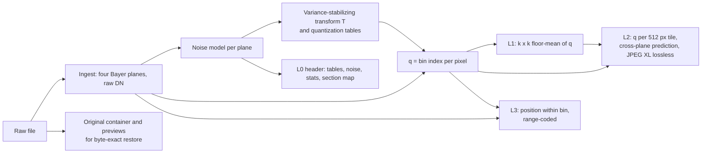

# The MiniRaw method

October 11, 2026; updated for format version 2 (D29, D30). This describes how MiniRaw works as implemented, why each part is designed as it is, and what the
measurements say about it. The original design is [SPEC.md](../SPEC.md). Every place the implementation departs
from it is numbered in [results/DEVIATIONS.md](../results/DEVIATIONS.md) (D1-D28), and those numbers are cited
below.

## 1. The idea

A raw photo is mostly noise. A sensor value carries the scene, plus shot noise that grows with brightness, plus
read noise. A lossless codec spends most of its bits on that noise, because noise doesn't compress. A lossy image
codec discards information by what looks unimportant on a display, which suits finished pictures, not raw data that
will be pushed, graded and denoised.

MiniRaw splits each sensor value at the noise:

- The part **above the noise** (which quantization bin, in units of the noise at that brightness) goes into a
  compact **hot tier**.
- The part **within the noise** (where in its bin the value lies) goes into a separate **cold layer**.

Together they restore every sensor value bit for bit. The hot tier alone decodes to an image where no pixel is off
by more than a stated fraction of the noise model's sigma (estimated from the image, so the bound is model-relative;
see [p0_benchmark.md](../results/p0_benchmark.md)). The cold layer can move to cheaper storage or be dropped.



### Layers

| Layer | Contents | Tier |
| --- | --- | --- |
| L0 header | Sensor metadata, per-plane noise model, quantization tables (`lo`), technical statistics, optional search embedding, section table | Hot; first read |
| IDX (format 2) | A 512 px index thumbnail, JPEG XL, about 34 KB, right after the header | Hot |
| L1 base (format 1) | k x k floor-mean of q: a small image used for preview and as a prediction input. Format 2 drops it. | Hot |
| L2 signal | q for every pixel, in 512 x 512 tiles | Hot |
| CTR | The original raw file's container, without sensor tiles and large previews (when supported) | Hot |
| L3 noise | Exact position of each value inside its bin, per tile | Cold |
| SRC | The original file's large embedded previews, repacked losslessly | Cold |

### Decode modes

| Mode | Reads | Output |
| --- | --- | --- |
| `index` | L0 | Header: metadata, noise model, statistics, embedding |
| `preview` | L0 and IDX (format 2), or L0 and L1 (format 1) | A small image |
| `signal` | L0, L1, L2 | Every sensor value to within the noise bound |
| `exact` | L0 to L3 | Every sensor value bit for bit, verified against the stored SHA-256 |

`signal` and `exact` also decode a rectangle, reading only the tiles it touches. Decoding to the source extension
(for example `.ARW`) rebuilds the original raw file: byte for byte with L3 and SRC, or as a valid file holding
near-lossless pixels without them.

## 2. Design principles

1. **The noise decides what is worth storing.** Quantization steps are a multiple of the measured noise sigma at
   each brightness. That gives an error bound for every pixel instead of an average.
2. **Decoding is integer-exact and table-driven.** The decoder never evaluates the transform. It reads integer
   tables from the header, so every platform decodes the same values (spec section 4). Floating point is confined
   to the encoder and to developing previews, which are not exact paths.
3. **Layers are ordered by temperature.** The hot tier comes first in the file, so truncating at L3 leaves a valid,
   smaller file (`miniraw strip`), and L3 can live in a sidecar (`miniraw split`).
4. **Random access is a property of the format.** Absolute offsets, a 16 KB first read and independent tiles make a
   crop cost about its own size.
5. **Nothing is hidden in averages.** Every claim is checked per pixel and per image: hash for exactness, the bound
   on every pixel, held-out images for generalization.

## 3. Ingest

`io_raw.read` opens the file with LibRaw (through `rawpy`) and reads the visible sensor area, `raw_image_visible`,
as uint16, cropped to even dimensions.
- Files whose colour filter isn't a 2 x 2 Bayer pattern (Fujifilm X-Trans, and a few others) are rejected with a
  reason.
- The mosaic splits into four half-resolution planes in the fixed order R, G1, G2, B, with the offsets needed to
  rebuild it.
- Values stay in raw DN; black level is never subtracted in the coded domain.
- Per-plane black, white level, white balance, colour matrix, orientation, default crop and capture EXIF go into
  the header so a decoded file can be developed and exported correctly.

## 4. Noise model

### 4.1 Model

Each plane's variance is affine in signal: Poisson shot noise scaled by the gain, plus Gaussian read noise.

```latex
\mathrm{Var}(x) = a \cdot \max(x - b,\ 0) + c
```

Here a is DN per electron, b the black level and c the read-noise variance in DN².

### 4.2 Estimating it from one image

When the file carries a DNG `NoiseProfile`, it is used, and its disagreement with the estimate is recorded. None of
the FiveK DNGs carry one, so in practice the single-image estimator runs:

1. **Blocks.** Split the plane into 8 x 8 blocks. Drop blocks containing a clipped pixel (0, or at least 98% of
   white).
2. **Per-block noise.** Robust variance of the Immerkær 3 x 3 Laplacian residual: MAD x 1.4826 / 6, squared. The
   kernel cancels planar gradients, which cut texture leakage from 16-740 DN² to the 0.13 DN² rounding floor on
   clean planes (D1).
3. **Bins.** Sort blocks into 32 log-spaced intensity bins. In each, take the median variance of the quietest 20%
   of blocks, divided by a Monte Carlo selection-bias constant (0.479) that undoes the low bias of keeping only the
   quietest (D2).
4. **Fit.** Huber-weighted least squares on relative residuals, a > 0, c >= 0.
   - Bins below σ 0.5 DN are left out, since the MAD of integer data can't measure them.
   - The fit is refitted without bins more than 1.25x above it. Texture can only inflate a bin, so the trimming is
     one-sided (D26).
5. **Validate.** After the transform of section 5, flat blocks should have unit noise. Validation passes when
   every bin with at least 50 kept blocks reads between 0.9 and 1.1 (D3).
6. **Lower-only correction.**
   - Where a bin reads below 0.9, the model over-estimates the noise there, which would discard signal. The model
     becomes min(affine, isotonic fit over well-populated bins), stored exactly as a piecewise-linear variance.
   - Readings above 1.1 are left alone: they are usually texture, and an under-estimate only costs bits (D26).
7. **No estimate possible.** If a plane has too few unclipped flat blocks (for example a very dark frame), the
   DNG profile is used if present; otherwise a model with every value in its own bin, which makes the hot tier
   lossless for that plane.

**Why the asymmetry.** Over-estimating σ makes the hot tier discard real image detail while still calling it "within
the noise". Under-estimating σ only makes bins narrower, so the file is a little larger and the error a little
smaller. Every fallback therefore errs low.

**How well it works.** On smooth synthetic planes with known noise, the decoded-error ratio is 1.0406 against a
theory of 1.041 (dev). Smooth scenes are easy, though. On a harness that keeps natural texture
(`bench/experiments/noise_texture.py`):
- The worst over-estimate of σ per plane has a median of 1.10x, a 90th percentile of 1.45x and a maximum of 3.3x.
- Before D26 those were 1.24x, 2.9x and 28x.
- The remaining error is concentrated where texture dominates very low noise, which no single-image flat-block
  estimator can separate (section 13).

## 5. Variance-stabilizing transform and quantization

### 5.1 Transform

The generalized Anscombe transform maps raw values to a domain where the noise is close to 1 everywhere:

```latex
T(x) = \frac{2}{a}\sqrt{a\,(x-b) + \tfrac{3}{8}a^{2} + c}, \qquad x \ge b
```

Below black it continues linearly with its slope at b. For a corrected (isotonic) model, T is the numerical integral
of 1/σ(x).

### 5.2 Forward table

The encoder builds one table per plane over every integer x from 0 to max(white, largest value), with step Δ in
units of sigma (default 1.0):

```latex
v_0 = 0, \qquad v_x = v_{x-1} + \min\!\left(1,\ \frac{T(x) - T(x-1)}{\Delta}\right), \qquad q(x) = \left\lfloor v_x + \tfrac12 \right\rfloor
```

The cap at 1 makes q rise by 0 or 1 per raw value. Every q is used, bins are contiguous, and where the noise is
below one DN each value already has its own bin. Two adjustments:
- **Clipped values** (at or above white) each get their own bin. They carry no noise, so they decode exactly at no
  cost (D20).
- **Wide bins.** A bin is split wherever its reconstruction point would miss the bound. T is concave, so in a wide
  bin the middle DN sits off the T-midpoint. This never happens at the default step on any benchmark image, and
  touches 32 of 560 planes at step 2.0 (D27).

### 5.3 Decoder tables

From the forward table come, per bin q:
- `lo[q]`, the smallest value
- `n[q]`, the bin size
- `rec[q] = lo[q] + (n[q] - 1) // 2`, the reconstruction value

Only `lo` is stored, delta-coded in the header. The decoder derives the rest with integer arithmetic.

### 5.4 Error bound

**The bound, checked on every pixel:** |T(x) - T(rec[q(x)])| <= Δ/2 plus one DN of slack.

**The cost in noise.** Quantization raises the effective noise by about 1.0% of sigma at Δ = 0.5, 4.1% at 1.0,
9.0% at 1.5 and 15.5% at 2.0. On the FiveK holdout the worst pixel per image at Δ = 1.0 has a median of 0.61σ, and
no pixel leaves the bound at any step from 0.5 to 2.0.

**Reconstruction choices.**
- **Format 2 default, `csafe` (D30).** One stored bit per bin flags even-sized bins whose ceiling keeps every value
  within the bound. Those bins alternate floor and ceiling on a pixel checkerboard; all others use the floor. Decile
  bias falls about 40% with no bound violations.
- The format 1 default is the spec's floor. For bins of even size it sits half a DN below the bin centre,
  which leaves a measurable bias on very low-noise sensors (D17).
- A `checker` alternative alternates floor and ceiling on a pixel checkerboard. It halves the bias but can push
  about 0.001% of pixels past the bound, so it is optional and recorded in the header.
- With `--dither`, signal mode draws a seeded uniform value within each bin instead.

### 5.5 The step trade-off

| Step | Hot tier, FiveK holdout (bits per pixel) | Worst pixel (median over images) |
| --- | --- | --- |
| 0.5 | 3.71 | 0.41σ |
| 1.0 (default) | 2.78 | 0.61σ |
| 1.5 | 2.28 | 0.85σ |
| 2.0 | 2.07 | 1.08σ |

A smaller step also makes the lossless total smaller: on the Sony A7 IV, step 0.5 brings it about 1% under JPEG XL
lossless. But the hot tier grows by about a third. The default favours the hot tier.

## 6. L1 base layer (format 1)

**Format 2 drops L1** (D29): L2 is smaller without it, and `IDX` (section 9a) serves preview and search better.
The rest of this section describes format 1, which v2 still reads and can write (`--format-version 1`).

L1 is the integer floor-mean of q over k x k blocks (construction A). k is the largest power of two that keeps the
plane's shorter side at least 128 px (D22; the spec said 256). L1 is coded whole with JPEG XL lossless.

**What it is used for.**
1. **Preview:** L1 through `rec`, developed by LibRaw (or the spec's numpy render) as a small image.
2. **Prediction in L2:** the low-pass level of G1, and the colour differences between planes (section 7).

**What the measurements say.**
- **G3 size gate.** It requires (L1 + L2) / (L2 coded without L1) <= 1.03. It is marginal: 1.031 on the FiveK
  holdout, roughly 115 KB per 10 MP image, of which L1 itself is about 65 KB.
- **L2 doesn't benefit from L1.** In every variant tried on dev, L2 was 0.8-3.6% *larger* with L1 than without:
  G1 predicted from L1 or coded directly, L1 stored at steps 1-16, at both 128 and 256 px. So in practice L1 is an
  added cost, not a non-redundant layer (`bench/experiments/l1_index.py`).
- **As a search index it falls short at the default size.** Neighbour overlap of its embedding with a full render
  is 0.76-0.77, against the spec's 0.80. The loss is its resolution: a full render shrunk to L1's colour
  resolution loses as much (`results/index_benchmark.md`).
- **No exactly decodable L1 met both bars.** None tested met both G3's size limit and the retrieval bar; a 20-35 KB
  lossy thumbnail would exceed the bar (section 13).
- **Construction B** (a reversible 5/3 wavelet whose LL band is L1) was worse: G3 1.096-1.127. JPEG XL codes
  wavelet detail bands less efficiently than pixels (D18).

## 7. L2 signal layer

L2 holds q for every pixel in 512 x 512 plane tiles (1024 x 1024 on the sensor). Each tile is independent, so a
region decodes from its own tiles.

**Cross-plane prediction (the format default).** Planes are coded in the order G1, G2, R, B. Each is coded as the
residual from an integer prediction built from already-decoded planes in the same tile, using `up(L1)` (L1 upsampled
by fixed-point bilinear interpolation):

| Plane | Prediction |
| --- | --- |
| G1 | `up(L1_G1)` (or nothing, with the experimental `g1_pred = "none"`) |
| G2 | mean of neighbouring G1 samples + (`up(L1_G2)` - `up(L1_G1)`) |
| R, B | mean of neighbouring G1 and G2 samples + (`up(L1_p)` - mean of `up(L1_G1)`, `up(L1_G2)`) |

All arithmetic is integer with rounding offsets, identical in encoder and decoder. Cross-plane prediction cut L2 by
5.7-8.9% at effort 7 on the Sony A7 IV. The dev measurements in section 6 indicate that the gain comes from the
neighbour terms, not the L1 terms.

**Coding.**
- Each residual plane is a grayscale image (packing P1), coded with JPEG XL lossless.
- The benchmark configuration uses effort 7; the CLI default is effort 4, which gives a 1.7% larger hot tier at
  half the encode time (D23).
- Residuals are signed, so each section starts with its minimum as an int32 offset and codes as unsigned 16-bit
  (D9).

## 8. L3 noise layer

For each pixel, L3 stores `kappa = x - lo[q]`, its position within its bin (0 to n[q] - 1).
- It is range-coded (the `constriction` library) under a uniform model per pixel. Bins of size 1 cost nothing.
- It is tiled exactly like L2, so a region decodes exactly from its own tiles.
- Exact decode is `x = lo[q] + kappa`, verified against the SHA-256 of the original mosaic stored in the header.

**Efficiency.** Coded L3 is within 0.006% of the ideal cost, the sum of log2 n[q] (median ratio 1.00006 on the
holdout). A context model was measured (`bench/experiments/l3_context.py`). It would lower the ideal cost by a median
0.05 bits per pixel: about half of G1's overhead, under 1% of the file, and only in the cold tier. It is deferred.

## 9. Header and container

A `.mraw` file is:
1. **A 16-byte preamble:** magic `MRAW`, version, flags (bit 0: L3 present), header length, header CRC32.
2. **The header:** zstd-compressed MessagePack.
3. **The sections,** ordered L1, L2, CTR, L3, SRC, each with its offset, length and CRC32 in the header.

| Header group | Contents |
| --- | --- |
| `sensor` | Dimensions, CFA offsets, black and white levels, white balance, colour matrices, bit depth, orientation, default crop |
| `source` | File name, camera, capture EXIF, SHA-256 of the mosaic, and the original container's status |
| `noise` | Step and per-plane model (affine a, b, c; or the piecewise-linear corrected model) |
| `tables` | Per-plane `lo`, delta-coded |
| `layout` | Tile size, k, upsampler, packing, L1 construction, reconstruction rule, L2 prediction, optional L1 options |
| `stats` | SNR at 18% grey, clipped share, mean and log-mean level, all relative to full scale (D28) |
| `idx` | Format 2: the `IDX` thumbnail's codec and size |
| `embed` | Format 2, optional: a list of int8 OpenCLIP embeddings of `IDX` (model, dim, dtype, scale, vector) |
| `sections` | The section table |

**Rules.**
- Offsets are absolute. The header is re-serialized into a reservation slightly larger than itself so offsets
  stay fixed (D10).
- A reader's first read is 16 KB, enough for the header in practice: a median 2.7-3.0 KB and at most about 4.8 KB
  on FiveK before D28 added about 120 bytes of statistics. The target is 8 KB.
- All file access goes through `RangeReader`, which logs every byte range. Tests assert that a crop reads only the
  header, L1 and the touched tiles; a 1024 x 1024 crop reads a median 1.46 MB.
- `strip` truncates at the first L3 byte and clears the flag. `split` writes L3 (and SRC) to a `.mraw.l3` sidecar,
  which `decode --sidecar` accepts.

**Technical statistics (D28).** The noise model is in raw DN, so it isn't comparable between cameras. `stats`
expresses noise as SNR at 18% of full scale, which on 498 FiveK images tracks ISO with a pooled rank correlation of
0.80 (the raw-DN slope: 0.48). It also records exposure as a log-mean level, which ranks night photos at an AUC of
0.90.

## 9a. Index thumbnail and embedding (format 2)

- **`IDX`.** Each plane is box-averaged in linear light to about 1024 px. The reduced mosaic is developed by LibRaw at
  half size (camera white balance, orientation applied), resized to 512 px on the long side and coded with JPEG XL
  at distance 1.0: about 34 KB.
- **Placement.** It sits immediately after the header, so a reader gets header and thumbnail in two short reads.
- **Search quality.** On 493 fresh FiveK images:
  - Its CLIP embedding has a median cosine of 0.980 with that of a full render.
  - Neighbour overlap@10 is 0.84 (CLIP) and 0.86 (SigLIP), against 0.76 for the format 1 L1.
  - Zero-shot classification stays within 1 point of the full render.
- **Embedding.** `encode --embed` stores an int8 OpenCLIP embedding (512 bytes for ViT-B/32) computed from `IDX`.
  - Indexing a file then reads only its 16 KB header.
  - Re-indexing with a newer model reads header plus `IDX` (median 51 KB).
  - A file can carry embeddings from several models.

## 10. Restoring the original raw file

For raws whose sensor data is lossless-JPEG tiles (Sony ARW lossless and lossless DNG, predictors 1-7), the encoder
also keeps what is needed to rebuild the original file (`source.py`):
- **CTR (hot):** the file skeleton without sensor tiles and large previews: TIFF structure, maker notes, tile
  headers, sensor margins outside the visible area, and where the TIFF tables point. About 0.2 MB on an A7 IV.
- **SRC (cold):** embedded previews over 256 KB, repacked losslessly. About 3.0 MB on an A7 IV.

With L3 and SRC, decoding to the source extension returns the identical file, checked against its SHA-256. Without
them, it returns a valid file in the original format holding the near-lossless pixels, re-encoded with the original
Huffman tables. The encoder verifies reproduction up front and records why when a format isn't supported; those
files restore as DNG with bit-exact sensor data instead.

`miniraw bundle` applies the same to a folder: raws become `.mraw`, JPEGs are repacked losslessly with JPEG XL, and
a manifest records every file's hash so `unbundle` can verify and restore everything.

## 11. Evidence

| Measurement | Result | Source |
| --- | --- | --- |
| **Sony A7 IV, 10 files, tuning set** | Hot tier 11.7 MB (0.28x the 41.2 MB ARW, worst pixel 0.72σ). All layers 27.7 MB, 2% under JPEG XL lossless. File-exact 30.9 MB. | [README](../README.md) |
| **FiveK holdout, 60 unseen images (40 linear, 14 cameras)** | Hot tier 0.41x the camera file. All layers 1.004x JPEG XL lossless (a tie). 60/60 exact. No pixel outside the bound at steps 0.5-2.0. | [fivek_benchmark.md](../results/fivek_benchmark.md) |
| **Against a fixed square-root curve** (in-camera lossy raw style) | Equal size at equal average error; the curve is 12-40% larger at equal worst-case error | [fivek_benchmark.md](../results/fivek_benchmark.md) |
| **Format 2 against format 1, 60 fresh images (paired)** | Hot tier -1.8%, lossless total -1.2% (0.987x JPEG XL), bias -38%, no bound violations, 60/60 exact | [v2_benchmark.md](../results/v2_benchmark.md) |
| **Search index, 498 FiveK images and 9 native raws** | The default L1 misses the retrieval bar (0.76-0.77 against 0.80); at 256 px it reaches 0.89. Indexing reads a uniform 67-251 KB. | [index_benchmark.md](../results/index_benchmark.md) |
| **Speed, A7 IV, Apple M1, 8 threads** | Encode 2.9 s (effort 7) or 1.4 s (effort 4); exact decode 0.66 s; signal decode 0.27 s; 1024 x 1024 region 53 ms | D23 |

**Protocol.** Tune on dev, freeze the configuration, run held-out images once. When a held-out run exposed failures
that drove a fix (D26), a fresh held-out set was drawn and the fix confirmed there. Per-image CSVs, per-split reports
and the commands to reproduce them are in `results/`.

## 12. Code map

| File | Role |
| --- | --- |
| `src/miniraw/io_raw.py` | Ingest, plane packing, detection of sources processed in camera |
| `src/miniraw/noise.py` | Estimator, fits, corrected models |
| `src/miniraw/vst.py` | Transform, forward table, decoder tables, bound check |
| `src/miniraw/layers.py` | L1, upsampling, cross-plane prediction, tiling, wavelet (construction B) |
| `src/miniraw/entropy.py` | JPEG XL and range-coder wrappers |
| `src/miniraw/codec.py` | Encoder, `Decoder`, decode modes |
| `src/miniraw/container.py` | File layout, `RangeReader`, strip and split |
| `src/miniraw/stats.py` | Header technical statistics |
| `src/miniraw/source.py` | Capture and restore of the original raw file |
| `src/miniraw/export.py` | DNG writer, LibRaw development, previews, image export |
| `src/miniraw/bundle.py` | Folder bundles |
| `src/miniraw/cli.py` | `miniraw` command line |
| `bench/` | Benchmark runner, reports, baselines, experiments |

## 13. Limitations and open problems

- **Lossless is a tie, not a win, on held-out data.** The 2% saving over JPEG XL is specific to the A7 IV set. One
  Leica D-LUX 3 frame is 15% larger than JPEG XL, for reasons not established.
- **The noise estimate can still run high on textured, low-noise images:** about 10% in σ in the median case on the
  textured harness, worse where texture dominates very low noise. A stored DNG profile, or a per-camera calibration
  cache, would remove the dependence on single-image estimation.
- **Bias.** The floor reconstruction leaves a per-decile offset (median 0.096σ against the spec's 0.02). The
  checker rule halves it at the cost of rare bound violations (D17).
- **Stabilized RMSE on very dark frames** can exceed the spec's 0.32 (0.321 on one holdout image), because most bins
  there are only 1-3 DN wide.
- **The base layer is not the index.** Format 1's L1 was neither free nor good enough for search; format 2
  replaces it with `IDX`. `IDX` still misses the plan's 0.90 neighbour-overlap bar (0.84-0.86), because of JPEG XL
  compression at about 34 KB. A truly non-redundant base layer would need an L2 coder that conditions on it, such as
  the spec's Phase 2 learned entropy model.
- **Scope.**
  - Only 2 x 2 Bayer sensors.
  - Byte-exact restore only for lossless-JPEG-tiled raws.
  - FiveK's cameras date from 2003-2009.
  - No render-based fidelity checks (+3 EV colour difference, PSNR).
  - The NUS-8 comparison with the learned codec RAWIC awaits manual downloads.
  - The implementation is Python with NumPy, JPEG XL and a range coder; there is no learned model.
