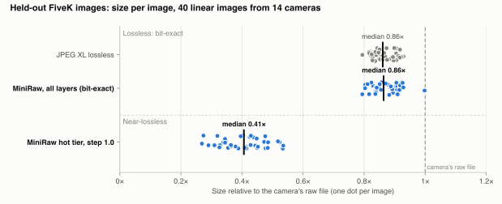
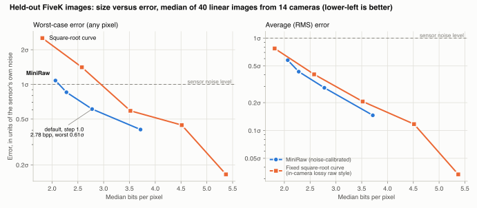

# MiniRaw on MIT-Adobe FiveK: held-out benchmark

October 11, 2026. Configuration [`configs/phase1.toml`](../configs/phase1.toml) with noise-model changes D26 and D27
([DEVIATIONS.md](DEVIATIONS.md)). Apple M4 Pro, Python 3.13, libjxl 0.12.0.

## Summary

On 60 FiveK DNGs that were first seen in this run (the **holdout** split), 40 of them true linear raw from 14
cameras:

- **The hot tier (L0-L2) is 0.41x the camera's raw file** [0.36, 0.43], with the worst pixel at 0.61σ (median
  over images) and **no pixel outside the error bound** at any step from 0.5 to 2.0.
- **Lossless ties JPEG XL.** Every layer together, sensor-exact, is 1.004x the size of tiled JPEG XL lossless
  [0.997, 1.010], and 0.86x the camera's file. The 2% saving measured on the Sony A7 IV set does not generalize.
- **Every exact decode matched its SHA-256** (60/60), as did region decodes and strip-and-restore.
- **Against a fixed square-root curve** (the approach of in-camera lossy raw), sizes tie at equal average error;
  at equal worst-case error the curve is 12-40% larger.
- **Two checks fail:** the decile bias check (median 0.096 against 0.02, the known reconstruction offset D17), and
  the stabilized RMSE on one image (0.321 against 0.32, from integer steps in a very dark frame). G3 is marginal
  (1.031 against 1.03).

Getting here took two fixes. The first run of the original 60-image test split found that the noise model was
fitting image texture as noise, and broke the error bound on 3 images. That is analysed in
[Failure analysis](#failure-analysis), and is why a fresh holdout split exists.

## Protocol

**Data.** MIT-Adobe FiveK DNGs (2003-2009 cameras), split by `bench/datasets.py` with seed 0, round-robin over
the 20 most common camera models:

| Split | Images | Role |
| --- | --- | --- |
| dev | 20 | Tuning. All design choices were made here. |
| test | 60 | Meant as the held-out set. Its first run exposed the failures below, so it was used to design D26 and is no longer held out. |
| holdout | 60 | The same round-robin continued, drawn after D26. Run once with the configuration frozen. |

Images with more than 5% empty codes in their histogram were processed in camera (companded or tone-curved;
Nikon D70/D80/D100/D700 and Leica M8 here). They are encoded and checked for exactness but left out of the size
and gate statistics, as in the spec. That leaves 40 linear holdout images.

**Measures.** For every image (`bench/run.py`):
- Sizes of each layer; the camera's own file (B1); JPEG XL lossless on the same sensor data, four Bayer planes
  in 512-pixel tiles at effort 7 (B2).
- Exact decode checked against the source's SHA-256; five random region decodes; strip-and-restore.
- Signal-mode error in units of the fitted noise sigma: the bound |T(x) - T(decoded)| <= step/2 + 1 DN on every
  pixel, worst pixel, RMSE and per-decile bias.
- A step sweep (0.5-2.0), and the square-root curve B5 at 7-11 bits for comparison.

Ratios are medians of per-image ratios with 95% paired-bootstrap intervals (10,000 resamples, seed 0).
Per-split reports: [report_holdout.md](report_holdout.md), [report_test.md](report_test.md),
[report_test_pre_d26.md](report_test_pre_d26.md), [report.md](report.md) (dev).

## Results (holdout)

| Ratio | Median [95% CI] |
| --- | --- |
| Hot tier (L0-L2) / camera raw file | 0.406 [0.360, 0.434] |
| Hot tier / JPEG XL lossless | 0.472 [0.410, 0.520] |
| All layers, sensor-exact / camera raw file | 0.864 [0.841, 0.891] |
| All layers / JPEG XL lossless | 1.004 [0.997, 1.010] |
| JPEG XL lossless / camera raw file | 0.861 [0.848, 0.875] |

<picture>
  <source media="(prefers-color-scheme: dark)" srcset="../docs/img/fivek_holdout_size_dark.svg">
  
</picture>

**Gates** (spec thresholds; linear images):

| Gate | Measure | Median [95% CI] | Threshold | Verdict |
| --- | --- | --- | --- | --- |
| G1 | (L1+L2+L3) / B2 | 1.004 [0.997, 1.010] | <= 1.03 | PASS |
| G2 | (L0+L1+L2) / B2 | 0.472 [0.410, 0.520] | <= 0.5 | marginal (pass) |
| G3 | (L1+L2) / L2 coded directly | 1.031 [1.027, 1.034] | <= 1.03 | marginal (fail) |
| G4 | tiling overhead | -0.010 [-0.012, -0.008] | <= 0.05 | PASS |
| G1 | exact decode, all files | 60/60 | all | PASS |
| G2 | error bound on every pixel, step 1.0 | 0 pixels | 0 | PASS |
| G2 | max decile bias | median 0.096, max 0.360 | <= 0.02 | FAIL (D17) |
| G2 | stabilized RMSE | median 0.290, max 0.321 | <= 0.32 | FAIL (one image) |

**Size versus error.** Error is in units of each image's fitted noise sigma.

| Step | Hot tier, bits per pixel | Worst pixel | RMSE | Pixels outside bound |
| --- | --- | --- | --- | --- |
| 0.5 | 3.71 | 0.41σ | 0.146 | 0 |
| 1.0 (default) | 2.78 | 0.61σ | 0.290 | 0 |
| 1.5 | 2.28 | 0.85σ | 0.434 | 0 |
| 2.0 | 2.07 | 1.08σ | 0.577 | 0 |

Matched to MiniRaw by interpolating over the step sweep, the square-root curve at 8-10 bits is
0.998-1.015x MiniRaw's size at equal RMSE (a tie) and 1.12-1.40x at equal worst-case error. At 7 and 11 bits
the curve falls outside MiniRaw's range and the comparison is extrapolated; see
[report_holdout.md](report_holdout.md), section 4.

<picture>
  <source media="(prefers-color-scheme: dark)" srcset="../docs/img/fivek_holdout_quality_dark.svg">
  
</picture>

**Per camera** (holdout, linear images; bits per pixel, medians; 2-3 images per camera, so treat single rows as
indicative):

| Camera | Images | Bits | Camera file | JPEG XL lossless | MiniRaw all layers | MiniRaw hot tier | Hot / camera file | Worst pixel |
| --- | --- | --- | --- | --- | --- | --- | --- | --- |
| Canon EOS 5D Mark II | 3 | 14 | 9.21 | 8.45 | 8.38 | 2.52 | 0.27 | 0.52σ |
| Canon EOS 40D | 3 | 14 | 9.41 | 7.68 | 7.56 | 3.07 | 0.33 | 0.53σ |
| Canon PowerShot G9 | 3 | 12 | 8.51 | 7.61 | 7.55 | 2.72 | 0.33 | 0.52σ |
| Canon EOS 450D | 3 | 14 | 7.66 | 6.94 | 6.95 | 2.55 | 0.34 | 0.53σ |
| Leica D-LUX 3 | 3 | 12 | 7.27 | 6.67 | 6.96 | 2.65 | 0.34 | 0.52σ |
| Canon EOS 10D | 2 | 12 | 7.30 | 6.30 | 6.24 | 2.83 | 0.39 | 0.58σ |
| Canon EOS 400D | 3 | 12 | 6.22 | 5.41 | 5.55 | 2.54 | 0.41 | 0.59σ |
| Canon EOS 5D | 3 | 12 | 6.93 | 5.74 | 5.69 | 2.82 | 0.41 | 0.63σ |
| Canon EOS DIGITAL REBEL | 3 | 12 | 6.55 | 5.35 | 5.48 | 3.01 | 0.43 | 0.64σ |
| Canon EOS-1D Mark II | 3 | 12 | 6.83 | 5.60 | 5.63 | 2.90 | 0.44 | 0.61σ |
| Canon EOS-1Ds Mark II | 3 | 12 | 6.09 | 5.14 | 5.22 | 2.63 | 0.45 | 0.63σ |
| Canon EOS 20D | 3 | 12 | 7.74 | 6.47 | 6.48 | 3.48 | 0.45 | 0.65σ |
| Canon EOS 30D | 2 | 12 | 6.05 | 4.98 | 4.98 | 3.05 | 0.51 | 0.75σ |
| Sony DSLR-A900 | 3 | 12 | 6.89 | 5.70 | 5.85 | 3.68 | 0.52 | 0.82σ |

## Failure analysis

### First test run (frozen configuration, before D26)

[report_test_pre_d26.md](report_test_pre_d26.md) found:

1. **Encoder crash** on a dark Leica M8 frame: a plane had too few unclipped flat blocks to fit a noise model.
2. **The error bound broke on 3 of 60 images** (Canon 30D, Canon 5D, Leica M8): 6,867 pixels, worst 0.62σ
   against a bound of 0.5σ plus 1 DN. All three used the isotonic fallback model.
3. **The isotonic fallback fired on 47 of 60 images**, and some fits were degenerate: a Sony A900 plane fitted
   a slope of 0 and then validated at up to 169σ.
4. **At step 2.0, 474,031 pixels in 12 images** missed the bound by up to 0.01σ (not a gate, but the bound is
   meant to hold at every step).

### Causes

- **Texture inflates the noise estimate.** The estimator takes the quietest 20% of 8x8 blocks in each brightness
  bin. At low ISO the noise is small next to image texture, so even those blocks carry texture. On dev and test
  linear images the fallback fired on 56-61% of planes at ISO 100-400, 31% at ISO 500-800 and 5% at ISO 1250
  and above. In 105 of its 113 planes, the trigger was a bin reading noisier than the affine fit. Three Canon
  30D frames at ISO 100, which share one true noise model, gave slopes of 0.115, 0.118 and 0.666; the third is
  the frame that later broke the bound.
- **The fallback raised the model to fit that texture.** It was built from bins with as few as 8 kept blocks
  (validation trusts only bins with at least 50) and extended its last value flat to the white level. In a
  Canon 30D frame a 14-block bin read σ 94 DN where the affine fit gave 26, and that set σ for every
  highlight. An over-estimated σ makes the hot tier discard real signal while still reporting it as within the
  noise. The steep jumps in T then broke the bound check.
- **Near-black bins below σ 0.5 DN** can't be measured with the median of integer data, and collapsed the Sony
  fit.
- **Step 2.0:** the decoder reconstructs at a bin's middle DN, not its T-midpoint. In wide bins, T's curvature
  moves that point off-centre by more than the one-DN slack.

**Evidence.** The existing synthetic check (`bench/synth.py`) blurs its scenes and passed. A new harness,
[`bench/experiments/noise_texture.py`](../bench/experiments/noise_texture.py), keeps texture: dev planes
box-downsampled 4x4 without blur, known Poisson-Gaussian noise added, residual source noise about 3% of the truth.
It reproduced the failure.

| Textured harness (dev images, 336 cases) | Before D26 | After D26 |
| --- | --- | --- |
| Fallback rate | 59% | 2% |
| Worst over-estimate of σ, median | 1.24x | 1.10x |
| Worst over-estimate of σ, 90th percentile | 2.90x | 1.45x |
| Worst over-estimate of σ, maximum | 28x | 3.3x |

### Fixes

- **Crash:** planes with no estimable noise use the DNG noise profile if present, else a lossless model.
- **D26:**
  - The fallback only *lowers* the model, where validation finds σ below 0.9; it never raises it above the
    affine fit. It uses only bins with at least 50 kept blocks.
  - The affine fit is refitted without bins more than 1.25x above it.
  - Bins below σ 0.5 DN are left out.

  Over-estimating σ loses signal; under-estimating only costs bits.
- **D27:** bins whose middle DN would miss the bound are split. This is encoder-only; steps 0.5 and 1.0 are
  byte-identical on all 140 images.

### Before and after

| Split | Linear images | Hot / JPEG XL | All layers / JPEG XL | Worst pixel, step 1.0 (median) | Pixels outside bound, step 1.0 | Pixels outside bound, step 2.0 | Images with a corrected model |
| --- | --- | --- | --- | --- | --- | --- | --- |
| test, before D26 | 41 of 60 | 0.468 | 1.003 | 0.61σ | 6,867 | 474,031 | 47 of 60 |
| test, after D26-D27 | 41 of 60 | 0.483 | 1.003 | 0.59σ | 0 | 0 | 24 of 60 |
| dev, after | 14 of 20 | 0.447 | 1.006 | 0.57σ | 0 | 0 | 5 of 20 |
| **holdout** | 40 of 60 | 0.472 | 1.004 | 0.61σ | 0 | 0 | 16 of 60 |

On test the hot tier grew by 3% (0.468 to 0.483 of JPEG XL): the bits that the inflated σ had been discarding.
Lossless size is unchanged, and the smooth synthetic ground-truth check on dev is unchanged (1.0406 against a
theory of 1.041). "Corrected" now means lowered; before D26 it meant raised.

## Open issues

- **Bias (D17).** The spec's floor reconstruction leaves a per-decile offset (median 0.096σ). The checker
  alternative halves it (0.056) and on the holdout breaks no bound, but it is not the default.
- **Stabilized RMSE on dark frames.** The 0.321 image is a dark Canon 30D frame with 74% of pixels in bins of
  3 DN or fewer. The spec's 0.32 limit assumes many DN per bin.
- **Residual σ inflation.** On the textured harness the affine slope is still about 20% high and σ about 10%
  high in the median case. The tail is planes where texture dominates very low noise; a single-image flat-block
  estimator can't separate the two there. Over-estimates of that size still keep errors near 0.55σ at step 1.0.
- **Leica D-LUX 3 lossless.** One holdout frame (`a0066-Ja_Pe-65`) is 15% larger than JPEG XL lossless, and a
  test frame was 6% larger before and after D26. The cause is unconfirmed: noise correlation measured in flat
  blocks was similar to other cameras.
- **Scope.** One dataset of older cameras, 2-3 images per camera. Render-based checks (+3 EV ΔE, PSNR) and the
  CLIP checks for L1 are not run. Timings come from a different machine than the README's M1 figures and are not
  compared here. The NUS-8 comparison with RAWIC is pending raw downloads ([BENCHMARK_DATASETS.md](../docs/BENCHMARK_DATASETS.md)).

## Reproduce

```sh
python -m bench.datasets --split holdout                 # 60 DNGs into data/raw/fivek
python -m bench.run --split holdout                      # per-image CSVs, results/per_image/holdout
python -m bench.report --split holdout --out results/report_holdout.md
python -m bench.experiments.heldout_summary holdout test_pre_d26 test dev
python -m bench.experiments.heldout_charts holdout       # docs/img/fivek_holdout_*.svg
python -m bench.experiments.noise_texture                # textured noise-model harness (dev only)
```
