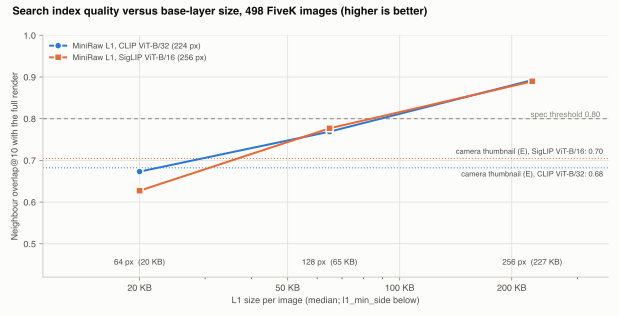

# MiniRaw's base layer as a search index

October 11, 2026. Protocol and decision rules: [docs/INDEX_BENCHMARK_PLAN.md](../docs/INDEX_BENCHMARK_PLAN.md),
fixed before the evaluation run. Data: 498 MIT-Adobe FiveK DNGs (`index500`, disjoint from every other split) and 9
native raws from raw.pixls.us. Models: OpenCLIP ViT-B/32 (`laion2b_s34b_b79k`, 224 px input, centre crop) and
SigLIP ViT-B/16 (`webli`, 256 px, whole frame). Apple M4 Pro, CPU only.

## Summary

The spec says MiniRaw's base layer (L1) "doubles as the search index" at no meaningful cost. On this evidence it
doesn't, at the default size, against the spec's own threshold. It is a reasonable index, closer to a full render
than the thumbnails cameras embed, and a 4x larger L1 passes. The loss is resolution, not compression.

| Hypothesis | Verdict | In one line |
| --- | --- | --- |
| **H1** L1 is as good as a full render | **Fails at the default size; passes at `l1_min_side` 256 for CLIP** | Default L1 neighbour overlap is 0.76 (CLIP) and 0.77 (SigLIP) against a threshold of 0.80. At 256 px it is 0.89, and CLIP zero-shot is within 1 point on every axis; SigLIP's time-of-day axis still misses by 2.2 points. |
| **H2** L1 is at least as good as the camera's embedded thumbnail | **Not shown** | L1 is closer to the full render than FiveK's embedded thumbnails (overlap 0.76-0.77 against 0.68-0.71), with equal CLIP zero-shot accuracy. But SigLIP scores it 6.7 points lower on time of day and 3.5 lower on subject. |
| **H3** Indexing MiniRaw is cheaper and uniform | **Uniform, not cheaper** | Always a 16 KB header read plus L1: median 83 KB, 90th percentile 136 KB, above the 80 KB target. Cameras' 160 px thumbnails cost 6-14 KB but search poorly; their large previews cost 0.6-7.4 MB. |
| **H4** Header data supports technical search (exploratory) | **Some signal, not cross-camera** | Measured noise tracks ISO within a camera (rank correlation 0.90), but varies 34x between cameras at the same ISO because it is stored in raw DN. |

**Where the loss comes from.** A control that shrinks the full render to L1's real colour resolution (R-plane) loses
as much as L1 does: overlap 0.785 against 0.757-0.769 under CLIP, and 0.791 against 0.767-0.777 under SigLIP. So L1
is about as good as an image of its size can be. What limits it is that the format sizes L1 at only 128-256 px per
plane, and on high-resolution sensors at the bottom of that range.

## Protocol

**Data.** `index500`: 500 FiveK DNGs in none of dev, test or holdout, drawn with seed 1 and stratified by FiveK's
`subject` label. 498 were processed; 2 have a non-Bayer CFA layout and were skipped. They come from 33 cameras, and
160 were processed in camera, which doesn't matter for semantics. Labels are FiveK's four category axes, with
`unknown` excluded:
- location: indoor or outdoor (464 images)
- time: day, dusk or night (358)
- light: sun_sky, artificial or mixed (466)
- subject: people, nature, man_made, animals or abstract (461)

The 20 dev images were used to debug the pipeline before the frozen run.

**Arms.** Every image in every arm is oriented for display, 8-bit sRGB.

| Arm | What it is |
| --- | --- |
| R | Full render with LibRaw: camera white balance, auto-brightness, half-size (at least 1,000 px, far above either model's input) |
| R-small | R shrunk to the demosaicked L1-128 size (median 366 x 490) |
| R-plane | R shrunk to L1-128's per-plane size (median 183 x 245), its real colour resolution |
| E | The thumbnail LibRaw extracts from the original file: FiveK's 256 x 171 bitmap (350 files) or an embedded JPEG (148 files, median 564 x 375) |
| L1-256, L1-128, L1-64 | L1 at `l1_min_side` 256, 128 (default) and 64, rendered by the same LibRaw call as R |
| L1-…-half | The same L1 rendered at half size: one RGB pixel per 2x2 cell, no demosaic interpolation |
| L1-spec | L1-128 through the spec's section 4.7 render (`Decoder.preview`), which normalizes exposure |

The L1 arms are built from MiniRaw's own tables. At the default size, the L1 mosaic was checked against the real
encoder's L1 on all 498 images: identical.

**Metrics.**
- Cosine similarity to R.
- Neighbour overlap@k: the share of each image's k nearest neighbours under an arm that are also its nearest
  under R.
- Zero-shot accuracy per axis, using two fixed prompts per label, averaged.
- Text-to-image mean average precision per axis.
- Bytes read to index a file.

Accuracy differences carry paired-bootstrap 95% intervals (10,000 resamples, seed 0).

**Changes from the plan.**
- **Added on dev, before the frozen run:** the half-size L1 arms and R-plane. Dev showed that R-small kept more
  real detail than L1, so it couldn't separate size from rendering.
- **The primary L1 render is LibRaw's,** matching R, rather than section 4.7's; section 4.7 is kept as L1-spec.
- **E is whatever LibRaw extracts.**
- **The native supplement** is 9 files from raw.pixls.us, one per camera model, including one Sony A7 IV file, instead of the 10 personal A7 IV files.
- **The embedding is not yet stored in the header,** so header-only indexing is not measured.

## Results

### Similarity to the full render (H1)

| Arm | CLIP cos (median / p10) | CLIP overlap@10 | SigLIP cos (median / p10) | SigLIP overlap@10 |
| --- | --- | --- | --- | --- |
| R | 1.000 / 1.000 | 1.000 | 1.000 / 1.000 | 1.000 |
| R-small | 0.997 / 0.991 | 0.925 | 0.998 / 0.994 | 0.926 |
| R-plane | 0.940 / 0.911 | 0.785 | 0.978 / 0.952 | 0.791 |
| E | 0.914 / 0.875 | 0.682 | 0.959 / 0.927 | 0.705 |
| L1-256 | 0.991 / 0.980 | 0.873 | 0.994 / 0.985 | 0.874 |
| L1-256-half | 0.994 / 0.985 | 0.893 | 0.996 / 0.988 | 0.890 |
| **L1-128 (default)** | 0.945 / 0.908 | **0.757** | 0.970 / 0.939 | **0.767** |
| L1-128-half | 0.935 / 0.905 | 0.769 | 0.975 / 0.949 | 0.777 |
| L1-64 | 0.832 / 0.704 | 0.524 | 0.902 / 0.818 | 0.566 |
| L1-64-half | 0.875 / 0.818 | 0.673 | 0.922 / 0.860 | 0.627 |
| L1-spec | 0.923 / 0.863 | 0.715 | 0.963 / 0.910 | 0.717 |

<picture>
  <source media="(prefers-color-scheme: dark)" srcset="../docs/img/index_overlap_dark.svg">
  
</picture>

Overlap at k = 5 and 50 tells the same story (`results/experiments/index_index500_metrics.csv`).

### Zero-shot classification and text retrieval (H1, H2)

Accuracy in percent, with text-to-image mean average precision in brackets.

**CLIP ViT-B/32**

| Arm | Location | Time | Light | Subject |
| --- | --- | --- | --- | --- |
| R | 91.2 (0.88) | 92.5 (0.78) | 68.5 (0.46) | 78.5 (0.84) |
| R-plane | 92.0 (0.89) | 92.7 (0.77) | 69.3 (0.47) | 77.7 (0.83) |
| E | 92.2 (0.87) | 93.0 (0.70) | 64.6 (0.46) | 77.4 (0.82) |
| L1-256-half | 91.2 (0.87) | 91.9 (0.77) | 69.3 (0.46) | 77.9 (0.84) |
| L1-128 | 91.6 (0.86) | 91.9 (0.75) | 73.4 (0.47) | 77.9 (0.84) |
| L1-128-half | 91.8 (0.88) | 91.3 (0.74) | 71.0 (0.47) | 77.0 (0.83) |
| L1-64-half | 91.4 (0.87) | 91.3 (0.76) | 69.7 (0.48) | 77.0 (0.82) |
| L1-spec | 92.5 (0.88) | 93.3 (0.74) | 72.5 (0.47) | 77.0 (0.82) |

**SigLIP ViT-B/16, 256 px**

| Arm | Location | Time | Light | Subject |
| --- | --- | --- | --- | --- |
| R | 93.1 (0.90) | 83.0 (0.73) | 73.4 (0.48) | 74.4 (0.83) |
| R-plane | 94.0 (0.90) | 83.0 (0.74) | 73.0 (0.47) | 74.8 (0.83) |
| E | 94.2 (0.91) | 82.7 (0.71) | 75.3 (0.48) | 75.5 (0.83) |
| L1-256-half | 93.3 (0.90) | 80.7 (0.70) | 73.0 (0.47) | 74.0 (0.83) |
| L1-128 | 93.8 (0.89) | 76.0 (0.68) | 72.5 (0.46) | 72.0 (0.84) |
| L1-128-half | 94.0 (0.89) | 79.3 (0.70) | 71.7 (0.47) | 72.5 (0.83) |
| L1-64-half | 95.0 (0.90) | 81.0 (0.71) | 71.0 (0.47) | 74.8 (0.81) |
| L1-spec | 93.8 (0.89) | 86.6 (0.73) | 73.2 (0.48) | 72.0 (0.83) |

Differences for L1-128 against R, in points with 95% intervals:

| Model | Location | Time | Light | Subject |
| --- | --- | --- | --- | --- |
| CLIP | +0.4 [-1.1, +1.9] | -0.6 [-2.2, +0.8] | +4.9 [+1.9, +8.2] | -0.7 [-2.4, +0.9] |
| SigLIP | +0.6 [-0.2, +1.7] | -7.0 [-10.1, -3.9] | -0.9 [-3.4, +1.7] | -2.4 [-4.6, -0.2] |

The same differences for L1-128 against E:

| Model | Location | Time | Light | Subject |
| --- | --- | --- | --- | --- |
| CLIP | -0.6 [-2.6, +1.1] | -1.1 [-3.1, +0.8] | +8.8 [+5.4, +12.2] | +0.4 [-1.7, +2.6] |
| SigLIP | -0.4 [-1.5, +0.6] | -6.7 [-10.3, -2.8] | -2.8 [-5.6, +0.0] | -3.5 [-6.1, -1.1] |

**Why SigLIP's time axis moves.**
- **It isn't brightness.** Mean display luminance of the L1 renders matches R-plane in every time category (for
  example 0.194 and 0.194 for night).
- **SigLIP's day-versus-dusk decision sits on a very thin margin.** The mean gap between its "day" and "dusk"
  scores is 0.010 in cosine, against 0.062 for CLIP. Small rendering changes flip many daytime images to "dusk":
  day recall 0.82 for R, 0.75 for L1-128, 0.79 for L1-128-half and 0.87 for L1-spec.
- **Consequence:** the time axis under SigLIP measures rendering sensitivity more than meaning. The decision rules
  were fixed in advance and are applied anyway.
- **The light axis is noisy in the other direction:** CLIP scores the camera thumbnail 3.9 points below R, and
  L1-128 4.9 points above.

### Index cost (H3)

**FiveK.**
- MiniRaw: the header is one 16 KB read on every file. Header plus L1 is a median 83 KB (90th percentile 136 KB,
  maximum 251 KB).
- FiveK's embedded thumbnail is an uncompressed 131 KB bitmap, or a median 107 KB JPEG. Neither is typical of
  camera files, hence the native supplement below.

**Native raws** (one file per camera model from raw.pixls.us; cosine to that file's full render, CLIP / SigLIP):

| Camera | File | Small thumbnail | Size | Largest preview | Size | MiniRaw L1, half render | L0 + L1 read | Cos, thumbnail | Cos, preview | Cos, L1 |
| --- | --- | --- | --- | --- | --- | --- | --- | --- | --- | --- |
| Canon EOS 5D Mark III | 26 MB | 160x120 | 13 KB | 5760x3840 | 1479 KB | 363x242 (k=8) | 120 KB | 0.77 / 0.91 | 0.99 / 0.97 | 0.98 / 0.99 |
| Canon EOS 90D | 35 MB | 160x120 | 14 KB | 6960x4640 | 2434 KB | 219x146 (k=16) | 67 KB | 0.77 / 0.91 | 0.98 / 0.98 | 0.88 / 0.95 |
| Nikon D750 | 26 MB | 640x424 | 114 KB | 6016x4016 | 975 KB | 377x252 (k=8) | 131 KB | 0.97 / 0.98 | 0.98 / 0.98 | 0.99 / 0.99 |
| Nikon Z 6 | 47 MB | 640x424 | 137 KB | 6048x4024 | 1292 KB | 379x253 (k=8) | 163 KB | 0.95 / 0.97 | 0.95 / 0.97 | 0.97 / 0.99 |
| Olympus E-M10 | 15 MB | 3200x2400 | 919 KB | 3200x2400 | 919 KB | 290x217 (k=8) | 110 KB | 0.92 / 0.96 | 0.92 / 0.96 | 0.83 / 0.96 |
| Panasonic DMC-GX7 | 15 MB | 160x120 | 6 KB | 160x120 | 6 KB | 215x215 (k=8) | 84 KB | 0.81 / 0.90 | 0.81 / 0.90 | 0.89 / 0.95 |
| Pentax K-3 II | 40 MB | 720x480 | 61 KB | 720x480* | 3522 KB | 377x252 (k=8) | 243 KB | 0.95 / 0.96 | 0.95 / 0.96 | 0.98 / 0.99 |
| Sony ILCE-7M3 | 26 MB | 160x120 | 10 KB | 1616x1080 | 1150 KB | 377x252 (k=8) | 219 KB | 0.78 / 0.85 | 0.94 / 0.97 | 0.99 / 0.99 |
| Sony ILCE-7M4 | 49 MB | 160x120 | 12 KB | 7008x4672 | 7424 KB | 220x147 (k=16) | 95 KB | 0.77 / 0.87 | 0.95 / 0.97 | 0.88 / 0.94 |

\* The Pentax's 3.5 MB preview lives in a SubIFD; exiftool's `PreviewImage` returned the 720 x 480 maker-note
preview, so that is what was embedded. The Panasonic sample was shot in 1:1 aspect mode.

What the table shows:
- **Camera files differ widely.** Canon, Sony and Panasonic carry a 160 x 120 thumbnail of 6-14 KB near the start of
  the file. It is cheap to read and poor for search (CLIP cosine 0.77-0.81). Nikon's 640 x 424 thumbnail
  (114-137 KB) is about as good as L1.
- **Finding previews takes format-specific parsing.** Offsets range from 17 KB to 36 MB into the file. Pentax and
  Olympus store previews in maker notes; CR3 stores them in ISO-media boxes, where exiftool exposes no offset.
- **MiniRaw's read is uniform and bounded:** 67-243 KB per file, at a layout every reader knows. It costs more
  than the small thumbnails and far less than the large previews.
- **L1 shrinks on high-resolution sensors.** `choose_k` gives k = 16 on the Canon 90D and Sony A7 IV, so L1 drops
  to about 146 px per plane, the smallest here. Those two have the lowest L1 similarity (CLIP 0.88).

### Header-only search (H4, exploratory)

- **Measured noise follows ISO within each camera.** The median rank correlation between EXIF ISO and the measured
  noise slope `a` is 0.90 across the 11 cameras with at least 6 images at 3 or more ISOs.
- **It is not comparable across cameras as stored.** At ISO 100 the median `a` per camera ranges from 0.078 to
  2.669 across 13 cameras, because it is in raw DN and depends on bit depth and gain. Cross-camera search would
  need noise stored relative to full scale.
- **Header-only features rank images by FiveK categories well above chance, but below embeddings:**

  | Query | Darkness (from L1) | EXIF ISO | Measured noise | CLIP on L1-128 | CLIP on R |
  | --- | --- | --- | --- | --- | --- |
  | Night (AUC) | 0.82 | 0.75 | 0.77 | 0.96 | 0.97 |
  | Artificial light | 0.69 | 0.71 | 0.67 | 0.75 | 0.75 |
  | Indoor | 0.61 | 0.70 | 0.59 | 0.91 | 0.92 |

  FiveK's labels can't test the technical queries the header is suited to ("noisy frames", "underexposed
  frames"); that would need its own labels.

## Verdicts against the pre-registered rules

| Rule | Result | Verdict |
| --- | --- | --- |
| H1: L1-128 overlap@10 ≥ 0.80 and zero-shot within 2 points of R on every axis | Overlap 0.757 / 0.767. Zero-shot: CLIP light +4.9 (better); SigLIP time -7.0 and subject -2.4 | **Fail** |
| H1, larger L1: L1-256 | CLIP: overlap 0.873, every axis within 0.6. SigLIP: overlap 0.874, time -3.1 [-5.0, -1.1]. Half-size render: overlap 0.893 / 0.890, SigLIP time -2.2 [-3.9, -0.8] | **Passes for CLIP; misses for SigLIP on the time axis** |
| H2: lower bound of L1-128 minus E above -2 points on every axis | CLIP: location and time intervals reach -2.6 and -3.1 (both include 0). SigLIP: time -6.7, subject -3.5 | **Not shown** |
| H3: one read of at most 80 KB on every file, and native files need more or vary | Median 83 KB, maximum 251 KB (FiveK) and 243 KB (native). Native reads do vary by format | **Uniform, but over the byte target** |

The spec's G3 retrieval conditions (overlap@10 ≥ 0.80; zero-shot within 2 points) fail at the default
`l1_min_side = 128`.

## What it means for the format

1. **Don't claim the index is free.** At the default size L1 costs 3.1% of the L2 it sits beside (G3 on the FiveK
   holdout), about 115 KB per image of which L1 itself is 65 KB, and it is below the spec's retrieval bar. Describe L1 as a built-in preview and index image of known
   quality.
2. **Size L1 by output pixels, not by a power-of-two minimum.**
   - `l1_min_side = 256` passes the overlap bar under both models, at a median 227 KB of L1 (about 160 KB more than
     now, roughly 5% of a typical FiveK hot tier).
   - Because `choose_k` only doubles `k`, L1 lands anywhere from 128 to 256 px per plane. On 33-45 MP sensors it
     lands at the bottom.
   - A rule that targets a fixed range (for example a shorter side of 192-384 px) would make quality consistent
     across sensors. This interacts with G3's size condition and is a product decision.
3. **Render L1 at half size.** One RGB pixel per 2x2 cell gives higher neighbour overlap than demosaicking at
   every size and under both models, and avoids the colour speckle a demosaic produces from block averages.
   Median cosine and zero-shot accuracy are mixed between the two.
4. **Store the embedding** (section 4.7, still unimplemented). Then indexing reads one 16 KB header. Re-indexing
   with a new model still needs only L1.
5. **Store noise relative to full scale** if header-only technical search is wanted.

## Limitations

- **FiveK is atypical.** Its labels are coarse, and its embedded thumbnails are Adobe renders rather than camera
  JPEGs. 9 native files show the range of camera thumbnails, not their distribution.
- **Two models, two prompts per label.** Zero-shot results on the time and light axes are sensitive to rendering;
  overlap and cosine don't depend on labels.
- **The reference is a LibRaw render.** A different reference pipeline (camera JPEG, Lightroom) would move every
  arm.
- **No timing.** Index cost is measured in bytes, not milliseconds. Bytes for camera files are each preview's own
  size; the parsing needed to find it is not counted.
- **Header-only indexing with a stored embedding is not measured,** because it isn't implemented.

## Reproduce

```sh
python -m bench.datasets --split index500                     # 500 DNGs, about 6 GB
python -m bench.experiments.index_eval prepare --split index500
python -m bench.experiments.index_eval embed --split index500   # needs open_clip_torch, torch, transformers
python -m bench.experiments.index_eval metrics --split index500
python -m bench.experiments.index_native data/raw/pixls        # needs exiftool; files from raw.pixls.us
python -m bench.experiments.index_charts index500
```

Per-image facts: `results/experiments/index_index500_images.csv`. Metrics:
`results/experiments/index_index500_metrics.csv`. Native files: `results/experiments/index_native.csv`.
Renders and embeddings are cached under `results/cache/index/` (not in git).
